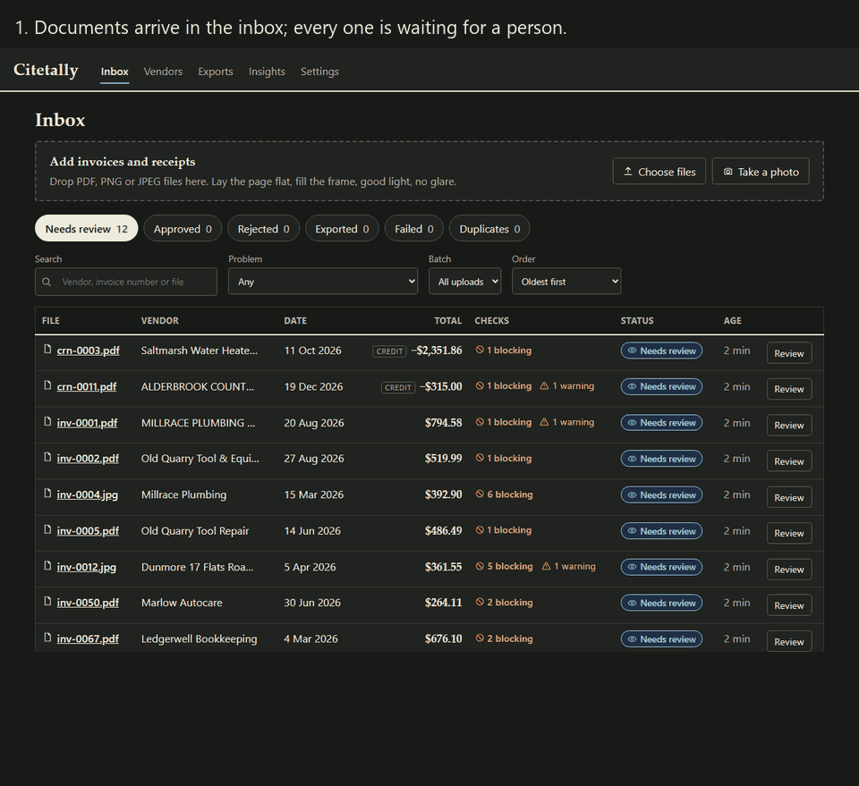
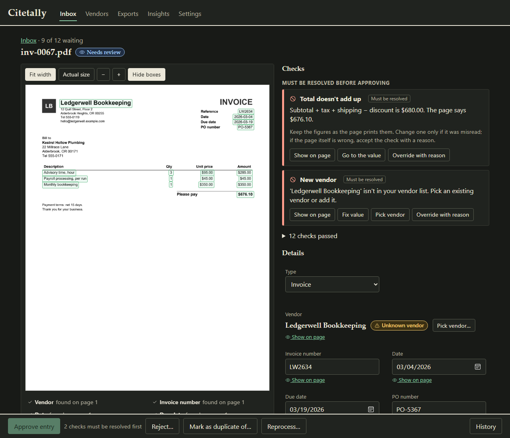
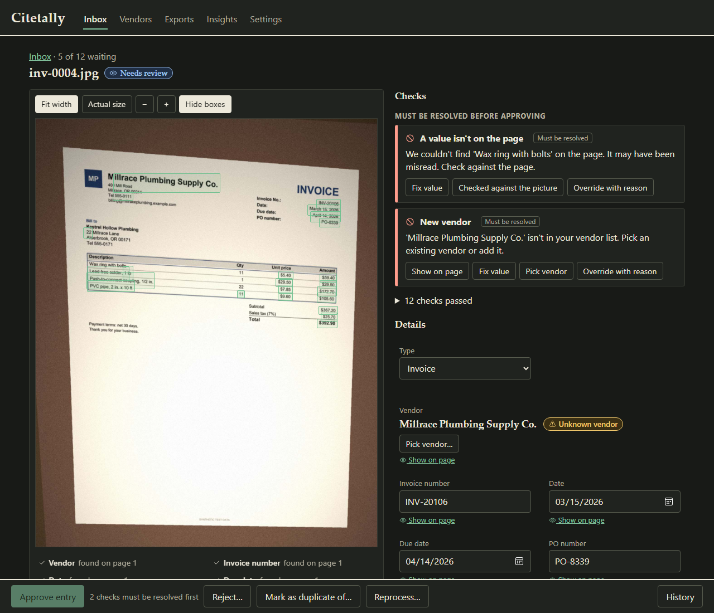
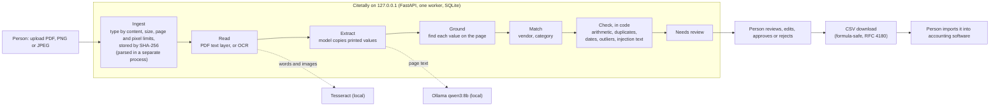

# Citetally

[](https://github.com/Nbhaskell/citetally/actions/workflows/ci.yml)

> **Demo data. All vendors, invoices and amounts are invented.** Every name, email address, phone number, invoice and receipt in this repository is synthetic. There is no real business data here, and the software has not been tried on any.

Citetally is a review desk for invoices and receipts at a small business. A local model reads each document and copies the printed values; plain code finds every value on the page, checks the arithmetic, duplicates and dates, and queues everything for a person to approve. **Nothing is ever paid, posted or sent automatically.** The only output is a CSV the person downloads and imports into their accounting software themselves.



*A slide show of real screens, made from the invented demo documents. It is not a screen recording.*

## The idea

**The model reads. Code computes, decides and checks.** The model's only job is to copy what is printed. It never does arithmetic, never reformats a number, never decides anything. After it answers:

- every value it returned has to be **found in the words on the page**, or the check `VALUE_IN_DOCUMENT` fails and the value is shown as not found (a printed number is never silently "fixed");
- line totals, subtotal, tax and total are re-added **in code**, in integer cents, never floats;
- duplicates, unknown vendors, odd dates, unusual amounts and instruction-like text on the page (`SUSPICIOUS_TEXT`) are decided by rules with unit tests;
- a person approves, edits or rejects every document. Blocking checks must be fixed or overridden **with a written reason** first.

| | |
|---|---|
|  |  |
| The page on the left with each found value outlined; the checks on the right. Approval is blocked until both are resolved. | A phone photo. One value could not be placed on the page, and the vendor is not on the list yet. Besides fixing a value or overriding with a reason, a person can confirm it against the picture; that is recorded with the approval. |

More screens: [a clean document ready to approve](docs/images/review-ready.png), [a file that could not be read](docs/images/failed-upload.png), [the empty inbox](docs/images/inbox-empty.png), [exports](docs/images/exports.png) and [insights](docs/images/insights.png).

## How it works



Everything runs on the person's own machine. Hosted models are off by default (`CITETALLY_ALLOW_HOSTED=false`) and every model call goes through one interface, `ModelProvider`. Documents move through a fixed set of statuses; a failure at any step leaves a plain reason and a Reprocess button, and never blocks the next document.

## How well it reads

Measured on invented documents in four conditions: clean digital PDFs, light scans, heavy scans and phone photos. The development split (140 documents) was used to look at errors. The held-out split (70 documents, 5 layouts never used while building) was run **once**, after the development numbers were written down, on the system as shipped. Share of printed header fields read exactly:

| Documents | Development | Held-out (one run) |
|---|---|---|
| Clean PDFs | 94.7% | 97.3% |
| Light scans | 92.1% | 80.0% |
| Heavy scans | 41.8% | 10.7% |
| Phone photos | 42.7% | 20.7% |
| All | 68.5% | 50.7% |

Other numbers, all documents (development, then held-out): money exact 70.3% and 56.2%; line-item F1 28.3% and 23.2%; planted problems caught 59.5% and 61.5%; clean documents wrongly blocked 67.3% and 80.7%. Intervals, the counts behind them and every limit are in [`eval/reports/eval_dev.md`](eval/reports/eval_dev.md) and [`eval/reports/eval_heldout.md`](eval/reports/eval_heldout.md), with the reading of the errors in [`eval_dev_analysis.md`](eval/reports/eval_dev_analysis.md) and [`eval_heldout_analysis.md`](eval/reports/eval_heldout_analysis.md).

**What that means, in plain words:**

- **Clean PDFs work.** Line items on clean PDFs score 98.0% (development) and 88.7% (held-out) F1.
- **Scans and photos do not, on the default path** (OCR text, then a text model). The checks catch much of it, but a person still has to look.
- **Showing the model the page picture helps a lot, and it was not switched on when these numbers were measured.** On the development split, heavy scans went from 41.8% to 94.1% and phone photos from 42.7% to 97.8%, at about four more seconds per page. It was not run on the held-out split. The system has since been changed; see the next section.
- **Other settings, development split:** forcing OCR on clean PDFs left header accuracy unchanged (95.6% against 94.7%; no difference found) but Tesseract drops single-digit quantities in several layouts, so strict line F1 fell from 98.0% to 34.6%. Letting the model think first scored 100.0% against 98.0% on line items and caught 100.0% against 72.7% of planted problems on clean PDFs, from one pass over 35 documents, at 13.0 against 5.4 seconds per page; with one pass that is a lead, not a result.
- **Most documents still go to a person.** Blocking checks fire on 67.3% (development) and 80.7% (held-out) of clean documents, for reasons the analysis lists: a currency symbol the model adds that is not printed, shortened vendor names, a tax rate returned in a form not found on the page, and OCR misreads.
- **Speed:** median 5.3 to 8.6 seconds per page by condition on one Windows machine ([`performance.md`](eval/reports/performance.md)).

### After these runs: what changed, the sealed run, and the pilot

The held-out table above describes the system as it was when that split was run. Afterwards the system was changed (decision D-063): scanned pages are read three ways and sent to a vision model with their picture, a text-layer PDF still goes to the text model, and grounding, vendor matching and the checks were corrected where the errors above came from. These changes were made and measured on the two development sets only, with a second invented business and new layouts (`dev2`). A 250-document set was written down and sealed first, and it was then run **once**, with the product's own settings, after the review-screen change described below was merged. It is now spent.

On the development sets, one pass each, header fields read exactly by condition (clean PDFs, light scans, heavy scans, phone photos): first set 96.9%, 99.6%, 93.6% and 96.9%; `dev2` 96.9%, 99.5%, 89.9% and 96.0%. Clean documents wrongly blocked are still 49.0% and 42.9%, above the 30% aimed for, almost entirely because values the picture supplies cannot yet be located on the poorest scans, and the rule that a value must be located has not been loosened. It costs a median of about 17 seconds per page on the test machine against about 7.5. These runs developed the fixes, so they flatter the system; the sealed run below is the test. See [`docs/DECISIONS.md`](docs/DECISIONS.md) (D-062, D-063) and [`eval/reports/eval_stage2_dev2.md`](eval/reports/eval_stage2_dev2.md).

#### The sealed run (the changed system, one run, 250 documents)

Share of printed header fields read exactly, and share of clean documents that the checks wrongly blocked (the person has to look at them although nothing is wrong):

| Documents | Header fields exact | Clean documents wrongly blocked |
|---|---|---|
| Clean PDFs (50) | 97.4% | 6.9% |
| Light scans (75) | 99.4% | 20.0% |
| Heavy scans (50) | 93.2% | 88.9% |
| Phone photos (75) | 96.0% | 67.3% |
| All (250) | 96.7% | 46.9% |

Other numbers, all documents: money exact 95.9%; line-item F1 91.8%; planted problems caught 84.0% (74 to 91%); median 15.1 seconds per page. Intervals, counts and every limit are in [`eval/reports/eval_sealed.md`](eval/reports/eval_sealed.md), read in D-066 of [`docs/DECISIONS.md`](docs/DECISIONS.md).

- **Reading held up.** The aim was at least 90% of header fields exact in each of the four conditions, and it was met in all four. The development results held on layouts the system had never seen.
- **Blocking is still too common.** The aim was at most 30% of clean documents wrongly blocked, and it was **not met** (46.9%). Almost all of it is one check, a value the model returned that cannot be located in the page words (44.6% of clean documents), worst on heavy scans and phone photos, where the page words are poor. The rule that a value must be located has not been loosened. Instead, the review screen offers one deliberate "checked against the picture" confirmation for those values, recorded with the approval as the reviewer's decision.
- **Weak spots, as they came out.** 0 of 7 planted tax mismatches were caught; why has not been looked into. 3 of 6 planted pieces of instruction-like text were caught. The tax misses were looked into afterwards; see the next subsection.

#### The pilot (one reviewer, 34 documents)

40 documents from the sealed set were reviewed in the app by the person who built the system, then typed by hand. 34 were approved and 6, all heavy scans, were rejected as unreadable. The 34 approved were typed by hand and timed with a console helper.

- **Time: the aim was met.** The median review took 28 seconds and the median typing took 108 seconds, a ratio of 0.26 against the aim of under 0.5. This rests on the median: a few long reviews pull the average up (see D-068).
- **Wrong values approved: the aim was not met.** The aim was that no wrong value is approved without a recorded override. 2 of the 34 approved entries held a wrong value with no override, and 3 more held one with an override. The cases were empty quantities that no check flags, a total changed to what the lines add up to instead of what the page prints, and a misread description. Typing was less accurate as well as slower: 12 of the 34 typed records had at least one difference from the truth.

Details, with the scoring correction made after the first look, are in D-067 and D-068 and in [`eval/reports/pilot.md`](eval/reports/pilot.md). One reviewer who knows how the system fails, invented documents, and 34 documents: read the figures as an indication.

**A second pilot, on `sealed2` documents** (after the review-screen aids of D-071). 36 of 40 were approved and typed. Time: the median review took 39 seconds and the median typing took 89 seconds, a ratio of 0.44 against the aim of under 0.5, but 1.01 on phone photos, where reviewing took as long as typing. Wrong values: 1 of the 36 approved entries held a wrong value with no override (an invoice number in which a capital I and a lower-case l are the same bare vertical stroke on the page, so the character could not be decided from it), and 0 held one with an override, against 5 in the first pilot on different documents. Typing again had more differences from the truth (15 of the 36 typed records). Details and the findings for the next round are in D-081 and [`eval/reports/pilot_sealed2.md`](eval/reports/pilot_sealed2.md).

#### Held-out against sealed, and two more sealed runs

The held-out figure (50.7% of header fields exact) and the first sealed figure (96.7%) are **not a before and after on the same documents**, and the gap is not generalisation improving. The held-out run measured the system as first built, on 70 documents in five layouts the system had never seen, and showed that scans and photos did not work. The fixes above were then made on the development sets, and the sealed run measured the changed system on 250 different documents with new layouts. What the pair supports is that the fixes held up on layouts they were not developed on. It does not support a claim that the system is 46 points better in general: different documents, a different invented business, and only one generator behind all of them.

The same method was used twice more. Each set was written down and its answer-key hash committed before the fixes it would test, it was run once after those fixes were merged, and it was then spent. Each used a new invented business and five new layouts.

| Run | Documents | Header fields exact | Money exact | Line-item F1 | Planted problems caught | Clean documents wrongly blocked |
|---|---|---|---|---|---|---|
| Held-out (first system) | 70 | 50.7% | 56.2% | 23.2% | 61.5% | 80.7% |
| `sealed` | 250 | 96.7% | 95.9% | 91.8% | 84.0% | 46.9% |
| `sealed2` | 300 | 93.1% | 91.7% | 87.6% | 73.2% | 42.2% |
| `sealed3` | 300 | 95.5% | 95.1% | 87.1% | 83.3% | 27.6% |

- **`sealed2` looked into the weak spots of the first sealed run** (0 of 7 planted tax mismatches caught, 3 of 6 pieces of instruction-like text) and was run after fixes for both. It caught 6 of 15 tax mismatches and 1 of 14 instruction texts. The causes were found afterwards: the tax check could not read a printed rate written with an unfamiliar label or a damaged decimal point, the instruction-text patterns matched little beyond the phrasings they were written from, and two layouts (the till slip and the pad) never printed the planted line, so nothing could have flagged those documents (D-072, D-078).
- **`sealed3` was run after a third round** (D-075, D-077, D-078): the optional RapidOCR engine reads the page a second time only to locate values, the printed tax rate is read through label variants and every reading, instruction text is matched by kind of request, and the layout fault was fixed. It caught 13 of 15 tax mismatches and 10 of 14 instruction texts, found 95.2% of returned values on the page (88.4% in `sealed2`), and wrongly blocked 27.6% of clean documents, inside the 30% aim for the first time. Median 18.6 seconds per page. The 10 of 14 is generous: the detector and the test phrasings were written by the same author, and the three misses on readable pages were new wordings it did not cover.
- **Still weak in `sealed3`.** Heavy scans: 87.0% of header fields exact, 73.0% line-item F1 and 64.9% of clean documents blocked. A value the model returned that cannot be located in the page words still fails 22.9% of clean documents, against an aim of 10% for any one check. Planted arithmetic errors flagged are below the 95% aim (line math 7 of 8, tax 13 of 15), and so are content duplicates (5 of 8). Several kinds scored lower than in `sealed2`, on 8 documents each, which is within what different documents could produce.

Differences of a few points between these runs should not be read as trends: each uses different documents, and the intervals in [`eval/reports/eval_sealed2.md`](eval/reports/eval_sealed2.md) and [`eval/reports/eval_sealed3.md`](eval/reports/eval_sealed3.md) are wide. The results are in D-072 and D-079 of [`docs/DECISIONS.md`](docs/DECISIONS.md).

**What this cannot tell you.** The documents are invented, with layouts and noise made by one generator; real invoices are messier and handwriting is absent. Truth is known by construction. There are 17 or 18 held-out documents per condition and 13 planted problems, so read the intervals, not the second decimal. One machine, one model, one OCR engine. The held-out split and the sealed sets are all spent: each was opened once, and any change made after reading them needs a new sealed set. The person who built the system also wrote the test documents, so they are unseen but not blind. The full list is in each report.

### Sealed means run once

A sealed test set is generated, and the hash of its answer key committed, before the fixes it will test. It is run once, with the product's own settings and one pass, after those fixes are merged. Its documents and key are not opened before the run, nothing is tuned on it, and it is never regenerated after the hash is committed (a test fails if the generator stops reproducing the hash, and the runner refuses a second run). Once read, it is spent: a change made because of what it showed is tested on a newer set. Four sets are spent so far (`held-out`, `sealed`, `sealed2`, `sealed3`); the last used another invented business and five more layouts, with its hash committed in [`eval/golden/citetally_v4_sealed3.sha256`](eval/golden/citetally_v4_sealed3.sha256). Its result is in D-079 and [`eval/reports/eval_sealed3.md`](eval/reports/eval_sealed3.md). A fifth (`sealed4`, a boat-yard business and five more layouts) exists, with its hash committed in [`eval/golden/citetally_v5_sealed4.sha256`](eval/golden/citetally_v5_sealed4.sha256), and has not been run. See also D-069, D-072, D-076 and D-080 in [`docs/DECISIONS.md`](docs/DECISIONS.md).

## Safety and privacy rules

These are in the code and checked by tests (see [`docs/HARDENING.md`](docs/HARDENING.md)):

- No code path pays, posts to accounting software, or sends email or messages.
- Uploaded files and the text in them are untrusted: type by content, size, page and pixel limits, parsing in a separate process with timeouts, nothing embedded is ever run, files are stored by hash. A 500-case fuzz run of damaged files found no crash, hang or stray file.
- Model output and document text are shown as text, never HTML, and never used to build paths, queries or URLs.
- Logs and audit events hold ids, stage names, timings and codes, never document text. A test plants canary text in documents, model replies, errors, filenames and reviewer notes and searches every log line, output and audit row for it.
- CSV export neutralizes spreadsheet formula injection.
- Binds to `127.0.0.1` only. **There is no login**: it is a single-user, local tool and must not be put on a network as it stands.

## Run it (Windows, PowerShell)

Windows 11 is the platform it was built and measured on. macOS and Linux are untested.

**You need:** Python 3.13, Node 20.19 or newer, [Tesseract 5](https://github.com/UB-Mannheim/tesseract/wiki) (found on `PATH` or in its default install folder; `TESSERACT_CMD` in `.env` overrides), and [Ollama](https://ollama.com) with the text model pulled (`ollama pull qwen3:8b`) and, for scans and photos, the vision model (`ollama pull qwen3-vl:8b-instruct`, about 6 GB; without it scans are read as text only, much less accurately, and `tools\check_env.py` says so). The vision model wants about 8 GB of graphics memory; on a card shared with a display or other programs it can be several times slower. Tests need none of the last two; reading a scan needs Tesseract; extraction needs Ollama.

**Optional second OCR engine.** [RapidOCR](https://github.com/RapidAI/RapidOCR) can read scans and photos in place of Tesseract: `pip install -r requirements-rapidocr.txt`, then `CITETALLY_OCR_ENGINE=rapidocr`, or `CITETALLY_OCR_LOCATOR=rapidocr` to keep Tesseract's text for the model and use RapidOCR's words only to locate values. Both are off by default and not installed by CI. Its OpenCV package bundles an LGPL-licensed FFmpeg library, a documented exception to the no-copyleft rule; the models run locally with no network access. See D-073 in [`docs/DECISIONS.md`](docs/DECISIONS.md).

```powershell
py -3.13 -m venv .venv
.\.venv\Scripts\python.exe -m pip install -r requirements-dev.txt
npm --prefix web ci
Copy-Item .env.example .env
.\.venv\Scripts\python.exe tools\check_env.py      # reports what is installed; never fails
.\.venv\Scripts\python.exe -m citetally            # API at http://127.0.0.1:8200
```

In a second terminal, `npm --prefix web run dev`, then open <http://127.0.0.1:5175> and press **Load demo documents**. Twelve invented documents (the set in `data/synthetic/demo`) are read and queued; a minute or two on the test machine.

Run the checks (no model, OCR program or network needed):

```powershell
.\.venv\Scripts\python.exe -m pytest
.\.venv\Scripts\python.exe -m ruff check .; .\.venv\Scripts\python.exe -m ruff format --check .; .\.venv\Scripts\python.exe -m mypy
npm --prefix web test; npm --prefix web run lint; npm --prefix web run typecheck
```

### Reproduce the development evaluation

The 210 invented documents are regenerated from a fixed seed (the golden file holding their known truth is stored in `eval/golden/`; the documents themselves are not). The run needs Ollama and Tesseract.

```powershell
.\.venv\Scripts\python.exe -m tools.synthetic.build                                         # about 2.5 minutes; writes data/synthetic/ and eval/golden/
.\.venv\Scripts\python.exe -m tools.evaluation.run --split tuned --variant baseline --pass 1   # about 30 minutes; saved under eval/runs/
.\.venv\Scripts\python.exe -m tools.evaluation.report --name dev                             # writes eval/reports/eval_dev.md and .json
```

Other settings (`forced_ocr`, `text_and_image`, `thinking`) and every development run are in `tools/evaluation/dev_runs.ps1` (several hours). Runs resume if interrupted. At temperature 0 with a fixed seed, repeated passes on the machine used here were identical; another machine may differ slightly. The held-out and sealed splits are deliberately not reproducible from these commands: the runner refuses them without a flag and a one-time lock (see D-058, D-059 and D-066 in `docs/DECISIONS.md`).

## Documents

Planning documents are in [`docs/`](docs/): [`PRD.md`](docs/PRD.md) (what and why), [`TRD.md`](docs/TRD.md) (architecture, checks, API, evaluation design), [`APP_FLOW.md`](docs/APP_FLOW.md), [`UI_UX_DESIGN_BRIEF.md`](docs/UI_UX_DESIGN_BRIEF.md), [`BACKEND_SCHEMA.md`](docs/BACKEND_SCHEMA.md) (exact names), [`IMPLEMENTATION_PLAN.md`](docs/IMPLEMENTATION_PLAN.md), [`HARDENING.md`](docs/HARDENING.md) and [`DECISIONS.md`](docs/DECISIONS.md) (every decision the plans did not cover, with the reason).

Part of a family of projects: [citedesk](https://github.com/Nbhaskell/citedesk), [citewise-markets](https://github.com/Nbhaskell/citewise-markets), [rag-project](https://github.com/Nbhaskell/rag-project), [citecheck](https://github.com/Nbhaskell/citecheck).

## License

MIT. See `LICENSE`.
