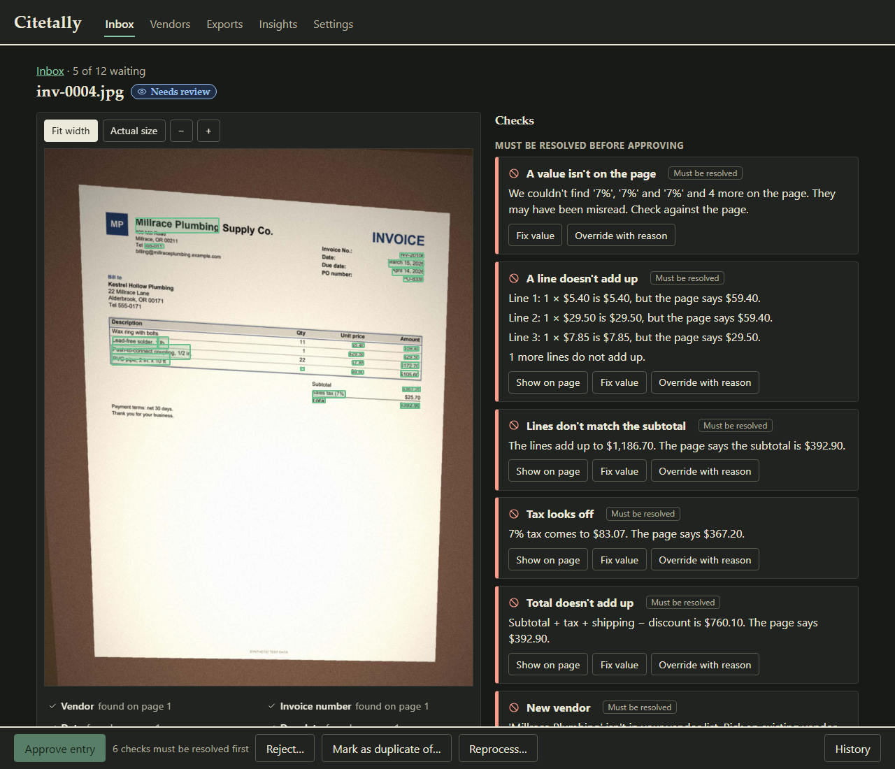
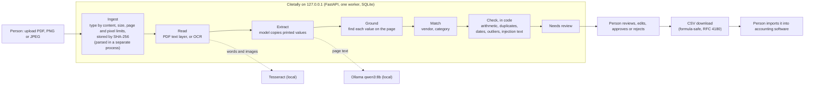

# Citetally

> **Demo data. All vendors, invoices and amounts are invented.** Every name, email address, phone number, invoice and receipt in this repository is synthetic. There is no real business data here, and the software has not been tried on any.

Citetally is a review desk for invoices and receipts at a small business. A local model reads each document and copies the printed values; plain code finds every value on the page, checks the arithmetic, duplicates and dates, and queues everything for a person to approve. **Nothing is ever paid, posted or sent automatically.** The only output is a CSV the person downloads and imports into their accounting software themselves.


*A slide show of real screens, made from the invented demo documents. It is not a screen recording.*

## The idea

**The model reads. Code computes, decides and checks.** The model's only job is to copy what is printed. It never does arithmetic, never reformats a number, never decides anything. After it answers:

- every value it returned has to be **found in the words on the page**, or the check `VALUE_IN_DOCUMENT` fails and the value is shown as not found (a printed number is never silently "fixed");
- line totals, subtotal, tax and total are re-added **in code**, in integer cents, never floats;
- duplicates, unknown vendors, odd dates, unusual amounts and instruction-like text on the page (`SUSPICIOUS_TEXT`) are decided by rules with unit tests;
- a person approves, edits or rejects every document. Blocking checks must be fixed or overridden **with a written reason** first.

| | |
|---|---|
|  |  |
| The page on the left with each found value outlined; the checks on the right. Approval is blocked until both are resolved. | A phone photo the OCR read badly. The checks catch the wrong numbers; nothing can be approved until a person looks. |

More screens: [a clean document ready to approve](docs/images/review-ready.png), [a file that could not be read](docs/images/failed-upload.png), [the empty inbox](docs/images/inbox-empty.png), [exports](docs/images/exports.png) and [insights](docs/images/insights.png).

## How it works



Everything runs on the person's own machine. Hosted models are off by default (`CITETALLY_ALLOW_HOSTED=false`) and every model call goes through one interface, `ModelProvider`. Documents move through a fixed set of statuses; a failure at any step leaves a plain reason and a Reprocess button, and never blocks the next document.

## How well it reads

Measured on invented documents in four conditions: clean digital PDFs, light scans, heavy scans and phone photos. The development split (140 documents) was used to look at errors. The held-out split (70 documents, 5 layouts never used while building) was run **once**, after the development numbers were written down, on the system as shipped. Share of printed header fields read exactly:

| Documents | Development | Held-out (one run) |
|---|---|---|
| Clean PDFs | 94.7% | 97.3% |
| Light scans | 92.1% | 80.0% |
| Heavy scans | 41.8% | 10.7% |
| Phone photos | 42.7% | 20.7% |
| All | 68.5% | 50.7% |

Other numbers, all documents (development, then held-out): money exact 70.3% and 56.2%; line-item F1 28.3% and 23.2%; planted problems caught 59.5% and 61.5%; clean documents wrongly blocked 67.3% and 80.7%. Intervals, the counts behind them and every limit are in [`eval/reports/eval_dev.md`](eval/reports/eval_dev.md) and [`eval/reports/eval_heldout.md`](eval/reports/eval_heldout.md), with the reading of the errors in [`eval_dev_analysis.md`](eval/reports/eval_dev_analysis.md) and [`eval_heldout_analysis.md`](eval/reports/eval_heldout_analysis.md).

**What that means, in plain words:**

- **Clean PDFs work.** Line items on clean PDFs score 98.0% (development) and 88.7% (held-out) F1.
- **Scans and photos do not, on the default path** (OCR text, then a text model). The checks catch much of it, but a person still has to look.
- **Showing the model the page picture helps a lot, but it is not switched on.** On the development split, heavy scans went from 41.8% to 94.1% and phone photos from 42.7% to 97.8%, at about four more seconds per page. But values read from the picture cannot yet be found in the OCR text, so every such document is flagged. It was not run on the held-out split.
- **Other settings, development split:** forcing OCR on clean PDFs left header accuracy unchanged (95.6% against 94.7%; no difference found) but Tesseract drops single-digit quantities in several layouts, so strict line F1 fell from 98.0% to 34.6%. Letting the model think first scored 100.0% against 98.0% on line items and caught 100.0% against 72.7% of planted problems on clean PDFs, from one pass over 35 documents, at 13.0 against 5.4 seconds per page; with one pass that is a lead, not a result.
- **Most documents still go to a person.** Blocking checks fire on 67.3% (development) and 80.7% (held-out) of clean documents, for reasons the analysis lists: a currency symbol the model adds that is not printed, shortened vendor names, a tax rate returned in a form not found on the page, and OCR misreads.
- **Speed:** median 5.3 to 8.6 seconds per page by condition on one Windows machine ([`performance.md`](eval/reports/performance.md)).

**What this cannot tell you.** The documents are invented, with layouts and noise made by one generator; real invoices are messier and handwriting is absent. Truth is known by construction. There are 17 or 18 held-out documents per condition and 13 planted problems, so read the intervals, not the second decimal. One machine, one model, one OCR engine. The held-out split is now spent: it was opened once, and any change made after reading it needs a new sealed set. The person who built the system also wrote the test documents, so they are unseen but not blind. The full list is in each report.

## Safety and privacy rules

These are in the code and checked by tests (see [`docs/HARDENING.md`](docs/HARDENING.md)):

- No code path pays, posts to accounting software, or sends email or messages.
- Uploaded files and the text in them are untrusted: type by content, size, page and pixel limits, parsing in a separate process with timeouts, nothing embedded is ever run, files are stored by hash. A 500-case fuzz run of damaged files found no crash, hang or stray file.
- Model output and document text are shown as text, never HTML, and never used to build paths, queries or URLs.
- Logs and audit events hold ids, stage names, timings and codes, never document text. A test plants canary text in documents, model replies, errors, filenames and reviewer notes and searches every log line, output and audit row for it.
- CSV export neutralizes spreadsheet formula injection.
- Binds to `127.0.0.1` only. **There is no login**: it is a single-user, local tool and must not be put on a network as it stands.

## Run it (Windows, PowerShell)

Windows 11 is the platform it was built and measured on. macOS and Linux are untested.

**You need:** Python 3.13, Node 20.19 or newer, [Tesseract 5](https://github.com/UB-Mannheim/tesseract/wiki) (found on `PATH` or in its default install folder; `TESSERACT_CMD` in `.env` overrides), and [Ollama](https://ollama.com) with the text model pulled (`ollama pull qwen3:8b`). Tests need none of the last two; reading a scan needs Tesseract; extraction needs Ollama.

```powershell
py -3.13 -m venv .venv
.\.venv\Scripts\python.exe -m pip install -r requirements-dev.txt
npm --prefix web ci
Copy-Item .env.example .env
.\.venv\Scripts\python.exe tools\check_env.py      # reports what is installed; never fails
.\.venv\Scripts\python.exe -m citetally            # API at http://127.0.0.1:8200
```

In a second terminal, `npm --prefix web run dev`, then open <http://127.0.0.1:5175> and press **Load demo documents**. Twelve invented documents (the set in `data/synthetic/demo`) are read and queued; a minute or two on the test machine.

Run the checks (no model, OCR program or network needed):

```powershell
.\.venv\Scripts\python.exe -m pytest
.\.venv\Scripts\python.exe -m ruff check .; .\.venv\Scripts\python.exe -m ruff format --check .; .\.venv\Scripts\python.exe -m mypy
npm --prefix web test; npm --prefix web run lint; npm --prefix web run typecheck
```

### Reproduce the development evaluation

The 210 invented documents are regenerated from a fixed seed (the golden file holding their known truth is stored in `eval/golden/`; the documents themselves are not). The run needs Ollama and Tesseract.

```powershell
.\.venv\Scripts\python.exe -m tools.synthetic.build                                         # about 2.5 minutes; writes data/synthetic/ and eval/golden/
.\.venv\Scripts\python.exe -m tools.evaluation.run --split tuned --variant baseline --pass 1   # about 30 minutes; saved under eval/runs/
.\.venv\Scripts\python.exe -m tools.evaluation.report --name dev                             # writes eval/reports/eval_dev.md and .json
```

Other settings (`forced_ocr`, `text_and_image`, `thinking`) and every development run are in `tools/evaluation/dev_runs.ps1` (several hours). Runs resume if interrupted. At temperature 0 with a fixed seed, repeated passes on the machine used here were identical; another machine may differ slightly. The held-out split is deliberately not reproducible from these commands: the runner refuses it without a flag and a one-time lock (see D-058 and D-059 in `docs/DECISIONS.md`).

## Documents

Planning documents are in [`docs/`](docs/): [`PRD.md`](docs/PRD.md) (what and why), [`TRD.md`](docs/TRD.md) (architecture, checks, API, evaluation design), [`APP_FLOW.md`](docs/APP_FLOW.md), [`UI_UX_DESIGN_BRIEF.md`](docs/UI_UX_DESIGN_BRIEF.md), [`BACKEND_SCHEMA.md`](docs/BACKEND_SCHEMA.md) (exact names), [`IMPLEMENTATION_PLAN.md`](docs/IMPLEMENTATION_PLAN.md), [`HARDENING.md`](docs/HARDENING.md) and [`DECISIONS.md`](docs/DECISIONS.md) (every decision the plans did not cover, with the reason).

Part of a family of projects: [citedesk](https://github.com/Nbhaskell/citedesk), [citewise-markets](https://github.com/Nbhaskell/citewise-markets), [rag-project](https://github.com/Nbhaskell/rag-project), [citecheck](https://github.com/Nbhaskell/citecheck).

## License

MIT. See `LICENSE`.
