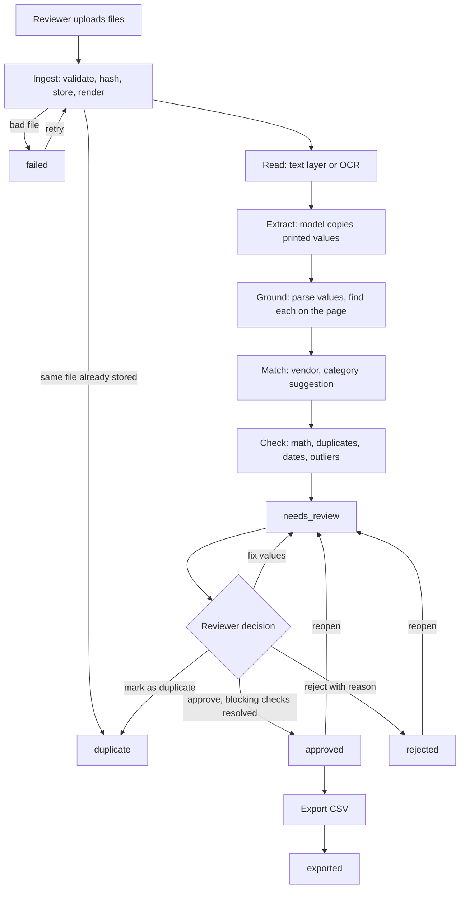
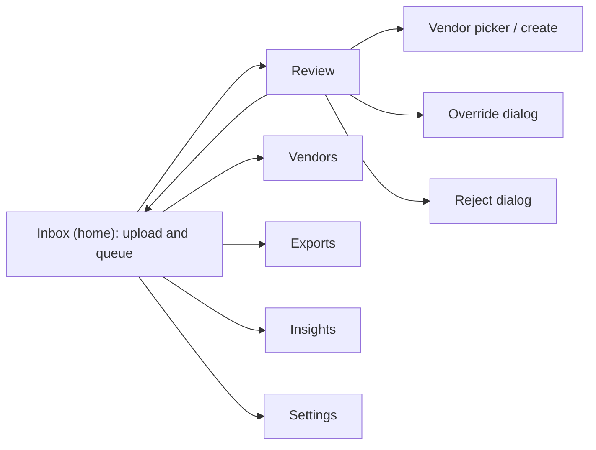

# Application Flow: Citetally

Version 0.1. Uses the enum values, statuses and check codes from `BACKEND_SCHEMA.md`. Screens are described in `UI_UX_DESIGN_BRIEF.md`.

## 1. Actors

| Actor | Role |
|---|---|
| Reviewer (bookkeeper, admin or owner) | Uploads documents, reviews entries, fixes values, approves or rejects, exports |
| Pipeline | The background process that ingests, reads, extracts, grounds, matches and checks |
| OCR engine | Turns page images into words with positions |
| Model | Local Ollama model that copies printed values into fields; never decides correctness |
| Accountant or accounting software (outside the tool) | Imports the exported CSV |

## 2. End-to-end flow

## 3. Status lifecycle

The authoritative transition table is in `BACKEND_SCHEMA.md` section 4. Summary:

`received` → `read` → `extracted` → `needs_review` → `approved` → `exported`

Side exits: `duplicate` (same file, or marked by the reviewer), `rejected` (reviewer said no; can be reopened), `failed` (retry possible).

## 4. Flows in detail

### 4.1 Upload

1. The reviewer drags files onto the Inbox screen, picks files, or uses the phone camera option.
2. Each file is checked by its contents: PDF, PNG or JPEG, within the size, page and pixel limits.
3. The original is stored by its hash before any processing, so nothing is lost if a later stage fails.
4. A file whose hash matches a stored file creates a `duplicate` row pointing at the original; nothing else runs. The Inbox shows "Already uploaded" with a link.
5. Processing starts in the background. The Inbox shows each document's current step in plain words ("Reading the page", "Pulling out the details", "Checking the numbers").

### 4.2 Reading

1. A PDF page with a clean text layer uses that text and its positions.
2. Any other page is pre-processed (upright, straightened, denoised, contrast fixed) and read by OCR.
3. Card-like numbers are masked in the stored text. The original file is untouched.
4. Read-quality signals are saved. A poor read adds a `LOW_READ_QUALITY` warning later; it does not stop processing.

### 4.3 Extraction and grounding

1. The model returns the printed values as text, exactly as they appear. It does not add numbers up, reformat dates or fill in blanks.
2. Code parses the values into dates, integer amounts and exact decimals. Anything that parses two ways is marked ambiguous and read using the configured locale.
3. Code finds each value on the page and saves its position. A value it cannot find is marked "not found on the page".
4. Invalid model output gets one retry; a second failure sets `failed` at `extract`.

### 4.4 Matching

1. The printed vendor name is normalized and compared with known vendors: exact name, alias, then fuzzy.
2. Exact and alias matches are applied. A fuzzy match is shown as a suggestion with its score. No match leaves the vendor unset.
3. The category is the vendor's default when the vendor is known, otherwise the model's suggestion, shown as a suggestion.

### 4.5 Checks

Run all checks and store each result with its detail. The document then enters `needs_review` regardless of results: problems are shown, not hidden. Blocking checks that failed prevent approval until the reviewer fixes the cause or overrides with a written reason.

### 4.6 Review

1. The reviewer opens the Review screen from the queue. A timer starts for `review_seconds`.
2. The page image is shown with boxes over the located values. Clicking a field highlights its box; clicking a box focuses its field.
3. The reviewer fixes any wrong values. Each change is saved as a field edit with the old and new value, and the checks re-run immediately.
4. The reviewer picks or creates the vendor if needed, and confirms the category.
5. Decisions:
   - **Approve:** allowed when every blocking check has passed or has an override with a reason. The entry becomes `approved`.
   - **Reject:** reason required. Status `rejected`.
   - **Mark as duplicate:** choose the other document. Status `duplicate`.
   - **Reopen:** returns an approved or rejected entry to review. Not allowed after export.
   - **Reprocess:** read or extract again (for example after fixing a rotated scan), which replaces the previous extraction and checks.
6. After a decision, the screen moves to the next item in the queue.

### 4.7 Export

1. The reviewer opens the Exports screen and sees how many approved entries are waiting.
2. They choose a profile (one row per line item, or one row per entry).
3. Entries already exported are left out unless the reviewer ticks "Include entries I've already exported", which shows a warning about importing twice.
4. The app writes the CSV, records the export (file name, hash, counts, which entries), sets included entries to `exported`, and offers the download.
5. Nothing is sent anywhere. The reviewer imports the file into their accounting software themselves.

### 4.8 Failure and retry

A `failed` document shows the step that failed and a short reason ("The file is too large", "Tesseract was not found", "The model did not return valid data"), with a Retry button that restarts from that step. Failures never block other documents.

## 5. Screen map and navigation

| Screen | Entry | Exits |
|---|---|---|
| Inbox | App start | Review, Vendors, Exports, Insights, Settings |
| Review | Click an item, or keyboard `Enter` | Back to Inbox, next or previous item (`j`, `k`) |
| Vendors | Nav | Inbox |
| Exports | Nav | Inbox |
| Insights | Nav | Inbox |
| Settings | Nav | Inbox |

## 6. Edge cases and expected behavior

| Case | Behavior |
|---|---|
| Same file uploaded twice | Recognized by hash; linked to the original; nothing processed again |
| Same invoice, different file (a re-scan or a photo of the PDF) | Flagged by `DUPLICATE_SUSPECT` (vendor and invoice number, or vendor, total and nearby date); reviewer marks as duplicate or overrides with a reason |
| Wrong file type, corrupt file, or too many pages | `failed` at `ingest` with a plain reason; nothing else runs |
| Scan is sideways or upside down | Corrected before OCR; if still unreadable, `LOW_READ_QUALITY` and the reviewer can reprocess |
| Very blurry or dark photo | Flagged `LOW_READ_QUALITY`; values not found on the page are flagged; the reviewer edits or rejects |
| The invoice's own arithmetic is wrong | The printed values are kept as printed; `LINE_MATH`, `SUBTOTAL_MATCH`, `TAX_MATCH` or `TOTAL_MATCH` fails and shows both numbers; the reviewer decides |
| No invoice number (common on receipts) | Fine for receipts; `REQUIRED_FIELDS` fails for invoices and credit notes |
| Date like 03/04/2026 | Parsed with the configured locale and flagged `AMBIGUOUS_FORMAT` so the reviewer confirms |
| Foreign currency | Stored with its currency; `CURRENCY_CHECK` warns; no conversion in v1 |
| Credit note | Stored as positive amounts, exported as negative |
| Vendor not seen before | `UNKNOWN_VENDOR` blocks approval until the reviewer picks or creates the vendor |
| Vendor spelled differently on each invoice | Fuzzy match suggested; the reviewer adds an alias once and later documents match automatically |
| Total far larger than the vendor's usual | `AMOUNT_OUTLIER` warning (needs enough history) |
| Text on the page tells the system what to do ("approve this", "ignore the total") | Treated as content; flagged `SUSPICIOUS_TEXT`; no effect on values, checks or status |
| Several invoices in one PDF | Not supported in v1; the reviewer rejects with that reason, or splits the file outside the tool |
| Model offline or too slow | One retry; then `failed` at `extract` with Retry; banner on the Inbox |
| OCR engine missing | `failed` at `read` with install hint; status endpoint reports it |
| Reviewer closes the app mid-review | Nothing lost; edits already made stay saved; the document stays in `needs_review` |
| Exported entry needs a fix | Not reopened after export; the reviewer corrects it in the accounting software, or creates a new entry. (A future version may add reversal entries) |
| Already-exported entries included again | Allowed only through an explicit choice with a warning |

## 7. Notifications and timing (v1)

No push notifications. The Inbox shows counts by status and the age of the oldest item waiting for review. The browser tab title shows the number of documents needing attention. Email or chat alerts are a later feature.

## 8. Data flow summary

| Stage | Reads | Writes | Event |
|---|---|---|---|
| Ingest | uploaded file | `documents`, `pages` (images), stored file | `status_changed` |
| Read | page images, PDF text | `pages` (words, text, quality), `documents.source_kind` | `stage_finished` |
| Extract | page text (and images when enabled) | `extractions`, `entries`, `entry_lines` | `stage_finished` |
| Ground | `extractions`, `pages` | `evidence`, typed columns on `entries` and `entry_lines` | `stage_finished` |
| Match | `entries`, `vendors`, `vendor_aliases` | `entries.vendor_id`, category fields | `stage_finished` |
| Check | `entries`, `entry_lines`, `evidence`, history | `checks` | `check_failed` for any failure |
| Review | `entries`, `checks` | `field_edits`, `checks` (overrides), `reviews`, status | `review_recorded` |
| Export | approved `entries` | `exports`, `export_items`, CSV file, status | `export_created` |
