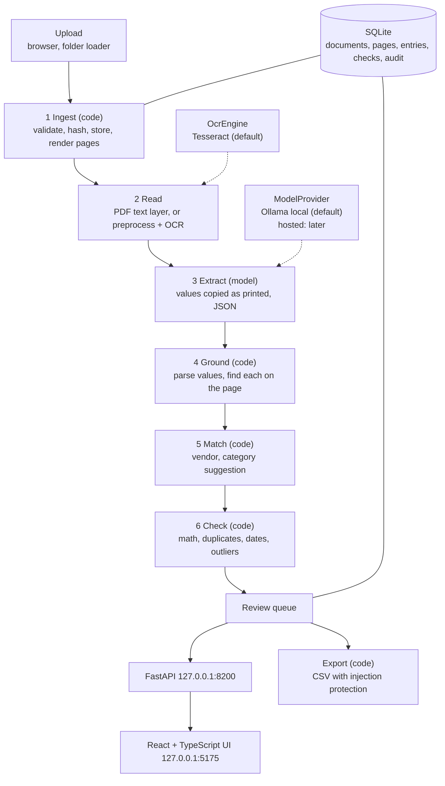

# Technical Requirements Document: Citetally

Version 0.1. Companion to `PRD.md`. Names for statuses, stages, check codes, fields and tables are defined in `BACKEND_SCHEMA.md` and must match exactly.

## 1. Architecture overview



Design principle carried over from `citewise-markets`: **the model reads; code decides, computes and checks.** The model copies text from the page into fields. Code parses, locates, recomputes and compares. The model never decides whether something is correct, a duplicate, or safe to export.

## 2. Technology choices

| Area | Choice | Why |
|---|---|---|
| Language | Python 3.13 | Matches the author's other projects |
| API | FastAPI + Pydantic v2 | Typed models, OpenAPI for generated front-end types |
| Database | SQLite (WAL), plain SQL migrations | Zero setup, one file, portable SQL |
| PDF text and boxes | `pdfplumber` (MIT) | Words with positions from a PDF's text layer |
| PDF page rendering | `pypdfium2` (Apache-2.0 / BSD) | Renders pages to images without system dependencies |
| Image handling | Pillow, OpenCV (headless), NumPy | Orientation, deskew, denoise, contrast, degradation for test data |
| OCR | Tesseract via a thin wrapper, behind `OcrEngine` | Free, local, word boxes and confidences; alternatives compared in a bake-off |
| Model | Ollama, `qwen3:8b` text model, temperature 0, behind `ModelProvider` | Local and free; same family as the sister projects |
| Vision (optional) | A vision-capable Ollama model chosen by measurement in Phase 4 | Not assumed to be good enough; off by default |
| Test data | `reportlab` for PDFs, Pillow and OpenCV for degradation | Truth is known by construction |
| Front end | React + TypeScript + Vite; types generated from the OpenAPI schema | Same stack as sister projects |
| Tests | pytest; Vitest for the UI | Unit tests need no model, OCR binary or network |
| CI | GitHub Actions, tests and lint only | Same pattern as sister projects |

Licensing rule: no AGPL or other copyleft dependencies, so the repository can stay MIT. Some popular PDF libraries are AGPL; do not use them. Check each new dependency's license before adding it. One documented exception: the optional RapidOCR engine (D-073), whose OpenCV package bundles an LGPL FFmpeg library; it is installed separately from `requirements-rapidocr.txt`, is not in the default requirements or CI, and nothing is redistributed with the project.

No LangChain or LlamaIndex. The pipeline is plain Python so every step that shapes a number is visible.

Exact model tags and OCR installation steps change over time. Confirm them against current Ollama and Tesseract documentation when you build, and record what you chose in `docs/DECISIONS.md`.

## 3. Components

```
citetally/
  citetally/
    config.py            settings from env, defaults
    db.py                connection, migrations runner, helpers
    models.py            Pydantic models and enums (single source of truth for values)
    money.py             parse, format and round money and decimals (Decimal only)
    dates.py             date parsing with ambiguity detection
    ingest.py            validation, hashing, storage, page rendering
    reading/
      text_layer.py      words and boxes from PDF text
      preprocess.py      rotate, deskew, denoise, contrast
      ocr.py             OcrEngine interface, TesseractOcr, FakeOcr for tests
      layout.py          reading-order, layout-preserving text from words
      masking.py         mask card-like numbers before model input
    extract.py           prompts, schema validation, calls ModelProvider
    grounding.py         locate printed values on the page, produce evidence
    matching.py          vendor matching, category suggestion
    checks/              one module per check code, pure functions
    pipeline.py          orchestrates stages, state transitions, retries
    providers/           ModelProvider interface, OllamaProvider, FakeProvider (HostedProvider later)
    exporting.py         export profiles, CSV safety
    api.py               FastAPI app and routes
    events.py            structured log helper (no document text)
  db/migrations/         numbered .sql files, append-only
  db/seed/               categories.json
  web/                   React app
  eval/                  golden set, runner, scorer, reports
  tools/                 synthetic document generator, demo loader, OCR bake-off, environment check
  tests/
  docs/                  planning documents
```

## 4. Pipeline stages

Each stage reads from and writes to the database, records an `audit_events` row, and advances `documents.status`. A stage can be re-run safely (writes are keyed by document and stage; re-running replaces that stage's output). One document is processed at a time by a single worker.

### 4.1 Ingest (code only)

- Accept `application/pdf`, `image/png`, `image/jpeg`. Determine type from the file's leading bytes, not the extension or the declared type.
- Limits (configurable): 20 MB, 10 pages, a pixel cap for images to defeat decompression bombs. Anything over a limit is `failed` at `ingest` with a plain reason.
- Compute SHA-256. If a stored document has the same hash, create a row with status `duplicate` and `duplicate_of` set, and stop.
- Store the original as `data/files/<sha256>`, never under its original name. Keep the original filename only as display text.
- Render PDF pages to PNG at a fixed resolution; load images, apply EXIF orientation, and save as PNG. Set `source_kind`: `digital_pdf` when a PDF has a usable text layer, `scanned_pdf` when it has pages but no usable text, `image` for photos.

### 4.2 Read

For each page:

1. **Text layer first.** If a PDF page has at least `TEXT_LAYER_MIN_CHARS` characters of text and the words look sane (mostly printable, plausible word lengths), take words and boxes from the text layer. `read_method = text_layer`. This is fast and exact.
2. **Otherwise OCR.** Pre-process the page image (convert to grayscale, correct rotation, deskew, denoise, normalize contrast, scale to a working size), then run the `OcrEngine`. `read_method = ocr`. Store each word's box and confidence, the mean confidence and the skew that was corrected.
3. Build layout-preserving reading-order text: group words into lines by vertical position, sort by horizontal position, pad gaps with spaces so table columns stay aligned. The model sees this text.
4. **Mask card-like numbers** (Luhn check) in the stored words and text. Account and routing numbers labelled as such are masked in text sent to any model. The original file stays untouched on disk.
5. Compute read-quality signals (mean confidence, word count, skew, text per page) for `LOW_READ_QUALITY`.

### 4.3 Extract (model)

- One call per document returns JSON matching a Pydantic schema (see `BACKEND_SCHEMA.md` section 3): entry type, vendor name, invoice number, dates, currency, line items, subtotal, tax, shipping, discount, total, and a category suggestion from the fixed list.
- **Every value is a copy of text printed on the page, or `null`.** The prompt forbids arithmetic, reformatting, guessing, and filling in a value that is not printed. If a subtotal is not printed, it must be `null`; code can compute one later for checking.
- The page text goes inside clearly delimited data blocks. The prompt states that everything inside the block is document content and never instructions.
- Use the provider's JSON-schema output option where available; validate with Pydantic regardless; on failure retry once with the validation error; a second failure marks the document `failed`.
- Temperature 0, fixed seed, token cap, timeout, thinking off by default (`CITETALLY_ENABLE_THINKING=false`), and one retry without thinking on timeout, as learned from stalled runs in `rag-project`.
- **Text-only by default.** `extract_mode = text_only`. `text_and_image` (a vision-capable model also sees the page image) is an experiment gated by a setting and enabled only if the Phase 4 measurements show it helps on low-quality scans.
- Prompt version string stored with the result (`extract-v1`). Tokens are recorded when the provider reports them.

### 4.4 Ground (code only)

For every extracted value, find where it is on the page.

1. **Parse** each printed string into a typed value with `money.py` and `dates.py`. Money becomes integer minor units (round-half-up); quantities and prices become `Decimal` strings. A string that cannot be parsed, or that parses two ways (for example `03/04/2026`, or `1.234` meaning one thousand two hundred thirty-four or one and a bit), is flagged for `AMBIGUOUS_FORMAT` and resolved by the business's configured locale, which defaults to `en-US`.
2. **Locate** the printed text in the page words: find the contiguous run of words that best matches, using normalized edit distance with a threshold (`CITETALLY_GROUNDING_MATCH_THRESHOLD`, default 0.85) to tolerate OCR slips. Store the union of the matched words' boxes as evidence (`found = 1`, page, box, match score).
3. **Numeric fallback.** If the string was not found but its parsed numeric value equals a number parsed from some word on the page, accept that location with a lower score.
4. A value with no location gets an evidence row with `found = 0`. `VALUE_IN_DOCUMENT` fails and names the field. This is the direct descendant of the figure and date check in `citecheck`: nothing reaches the reviewer as trustworthy unless it can be seen on the page.

### 4.5 Match (code only)

- **Vendor:** normalize the printed name (lowercase, strip punctuation and legal suffixes such as Inc, LLC, Co). Match in order: exact normalized name, alias, then fuzzy matching (token-set similarity). Apply exact and alias matches automatically. A fuzzy match is only a suggestion with its score; the reviewer chooses. No match leaves `vendor_id` empty, so `UNKNOWN_VENDOR` fails until the reviewer picks or creates a vendor.
- **Category:** use the vendor's default category when the vendor is known (`category_source = vendor_default`); otherwise use the model's suggestion (`model`). The reviewer confirms by approving or changes it (`manual`).
- **Document type:** `entry_type` comes from the model and can be changed by the reviewer; credit notes export with negative amounts.

### 4.6 Check (code only)

All checks are pure functions over the entry, its lines, its evidence and the database. Each stores `passed`, `blocking` and a JSON `detail`. Defaults are in `BACKEND_SCHEMA.md`.

| Check | Rule |
|---|---|
| `REQUIRED_FIELDS` | Required fields for the entry type are present and parsed |
| `VALUE_IN_DOCUMENT` | Every extracted amount, date and number has `found = 1` in evidence |
| `LINE_MATH` | For each line with quantity, unit price and amount, `round_half_up(quantity × unit_price)` equals `amount` within `CITETALLY_MATH_TOLERANCE_MINOR` (default 1) |
| `SUBTOTAL_MATCH` | Sum of line amounts equals the stated subtotal within tolerance. If no subtotal is printed, the check is skipped and recorded as not applicable |
| `TAX_MATCH` | If a rate is printed, `round_half_up(taxable amount × rate)` equals the stated tax within one minor unit per taxable line (minimum one). If no per-line rate was read, report the implied rate and compare it with the vendor's history as a warning inside the detail; and where the page prints one rate beside the word "tax", the stated tax must be at most that rate on the subtotal and shipping, and must equal that rate applied to some non-empty set of the lines (with or without shipping, with or without the discount), within one minor unit per line in the set. Not applied with no lines, a line without an amount, or more than 14 lines (D-070) |
| `TOTAL_MATCH` | Subtotal (or the sum of lines when no subtotal is printed) plus tax plus shipping minus discount equals the stated total within tolerance |
| `DUPLICATE_SUSPECT` | Same vendor and normalized invoice number as another non-rejected entry, or same vendor, total and currency with an entry date within `CITETALLY_DUPLICATE_DATE_WINDOW_DAYS` (default 7) |
| `UNKNOWN_VENDOR` | `vendor_id` is set |
| `AMOUNT_OUTLIER` | With at least `CITETALLY_OUTLIER_MIN_HISTORY` (default 5) approved entries for this vendor and currency, flag a total at least `CITETALLY_OUTLIER_RATIO` (default 3) times the median, or at most its reciprocal. With less history, record "not enough history" and pass |
| `DATE_SANITY` | Entry date is not in the future (beyond one day), due date is not before the entry date, entry date is not older than `CITETALLY_MAX_AGE_DAYS` (default 400) |
| `CURRENCY_CHECK` | Currency differs from the default or from the vendor's default |
| `LOW_READ_QUALITY` | Mean OCR confidence below `CITETALLY_LOW_CONFIDENCE` (default 75), very few words, or large corrected skew |
| `AMBIGUOUS_FORMAT` | Any parse flagged ambiguous in Ground |
| `SUSPICIOUS_TEXT` | Page text contains instruction-like phrases aimed at an assistant or approver (patterns are configurable) |

Because the model copies printed values and never recomputes, an invoice whose own arithmetic is wrong is flagged, not silently repaired.

After a reviewer edits a value, the checks re-run. Overrides are cleared on edit and must be given again, so an override always refers to the values the reviewer actually saw when approving.

### 4.7 Export (code only)

Two profiles, both written by the application, never by a model:

- `lines_csv`: one row per line item, with entry-level columns repeated (vendor, invoice number, dates, currency, category, entry total).
- `entries_csv`: one row per entry (vendor, invoice number, dates, currency, subtotal, tax, shipping, discount, total, category).

Rules:
- Amounts are written as decimal strings from integer minor units, with a `.` decimal separator and no thousands separators. Credit notes are negative.
- Only `approved` entries are exported, and they become `exported`. Already-exported entries are excluded unless the user explicitly includes them.
- **Neutralize formula injection** in every text cell: a cell starting with `=`, `+`, `-`, `@`, tab or carriage return is prefixed so a spreadsheet treats it as text. Quote according to RFC 4180.
- Record the file name, hash, entry count and row count in `exports` and `export_items`.
- Profiles for specific accounting software are adapters added later, each after reading that software's current import specification.

## 5. Interfaces

```python
class OcrEngine(Protocol):
    name: str
    def read_page(self, image: "PageImage") -> "OcrPage": ...   # words with boxes and confidences, mean confidence

class ModelProvider(Protocol):
    name: str                       # "ollama" or "hosted"
    supports_vision: bool
    def generate_json(self, *, system: str, user: str, schema: dict,
                      images: list[bytes] | None = None,
                      temperature: float = 0.0, max_tokens: int = 2000,
                      timeout_s: int = 180, seed: int | None = 0) -> "ModelResult": ...
                      # ModelResult: parsed json, raw text, input_tokens, output_tokens, duration_ms

class ExportProfile(Protocol):
    name: str
    def render(self, entries: list["EntryExport"]) -> bytes: ...
```

Everything the pipeline needs from a model goes through `ModelProvider`. That is what makes the later hosted switch a contained change.

## 6. Local first, hosted later

v1 runs entirely on the user's machine: PDF text, OCR and the Ollama model. The hosted option is designed now and built later.

**What a hosted switch changes** (and nothing else):
1. A `HostedProvider` class implementing `ModelProvider` (the first candidate is the Claude API, which accepts images, so `extract_mode = text_and_image` becomes practical).
2. Configuration: `CITETALLY_MODEL_PROVIDER=hosted`, the provider's key held as a server-side secret in the environment, never in the repository or the browser, and `CITETALLY_ALLOW_HOSTED=true`. Without the second setting, hosted mode refuses to start.
3. Prompts are re-checked against the golden set, because a different model reads differently. No prompt is assumed to transfer.

**Guardrails for hosted mode:**
- The status endpoint and every screen show a persistent banner: "Hosted model mode: page content is sent to <provider>".
- Mask card-like and labelled account numbers in text sent out (already done before any model call). Page images cannot be masked the same way; the documentation must say so, and image mode stays off unless explicitly enabled.
- Spending cap set at the provider, and a per-document token count recorded in `extractions` so cost per document can be reported.
- Never use hosted mode for real client documents until the user has read the provider's data-handling terms. Do not enable it by default.

**What gets reported when it is added:** the same golden set run under both providers, with accuracy by condition, time per document and cost per document, side by side, with the usual limits. That comparison is the evidence for when local is enough and when hosted is worth paying for.

## 7. HTTP API (v1)

Base `http://127.0.0.1:8200`. All JSON except file upload and download. Request and response models are Pydantic classes; the OpenAPI schema generates the web app types.

| Method and path | Purpose |
|---|---|
| `POST /api/documents` | Upload one or more files (multipart); returns document ids and statuses; processing starts in the background |
| `GET /api/documents` | List with filters `status`, `check`, `q`, `batch`, cursor pagination |
| `GET /api/documents/{id}` | Full detail: document, pages, extraction, entry with lines, evidence, checks, edits, history |
| `GET /api/documents/{id}/pages/{n}/image` | The rendered page image |
| `POST /api/documents/{id}/reprocess` | Body: `from_stage` (`read` or `extract`) |
| `PATCH /api/entries/{id}` | Edit header fields, lines or category; records `field_edits` and re-runs checks |
| `POST /api/entries/{id}/vendor` | Set the vendor: existing id, or create new from the printed name |
| `POST /api/documents/{id}/approve` | Body: `overrides: [{check_code, reason}]`; refused if any blocking check is unresolved |
| `POST /api/documents/{id}/reject` | Body: `reason` |
| `POST /api/documents/{id}/reopen` | Return an approved or rejected document to review |
| `POST /api/documents/{id}/mark-duplicate` | Body: `duplicate_of` |
| `GET /api/vendors` / `POST /api/vendors` | List and create |
| `POST /api/vendors/{id}/aliases` | Add an alias |
| `POST /api/vendors/{id}/merge` | Body: `into` |
| `GET /api/categories` | List |
| `POST /api/exports` | Body: `profile`, optional `entry_ids`, `include_exported`; returns the export record |
| `GET /api/exports` | History |
| `GET /api/exports/{id}/download` | The CSV file |
| `GET /api/insights` | Aggregates |
| `GET /api/status` | Provider, model, OCR engine, database health, hosted-mode flag, synthetic-data flag |

Errors use one shape: `{ "error": { "code": "...", "message": "...", "request_id": "..." } }`.

## 8. Configuration

Environment variables with defaults in `.env.example`. Settings owned by this project use the `CITETALLY_` prefix; standard tool variables keep their usual names.

`CITETALLY_DB_PATH`, `CITETALLY_DATA_DIR`, `CITETALLY_PORT=8200`, `CITETALLY_MODEL_PROVIDER=ollama`, `OLLAMA_URL`, `CITETALLY_TEXT_MODEL=qwen3:8b`, `CITETALLY_VISION_MODEL` (empty means disabled), `CITETALLY_EXTRACT_MODE=text_only`, `CITETALLY_ENABLE_THINKING=false`, `CITETALLY_OCR_ENGINE=tesseract` (or `rapidocr`), `CITETALLY_OCR_LOCATOR=none` (or `rapidocr`: its words only locate values, D-075), `TESSERACT_CMD`, `CITETALLY_MAX_FILE_MB=20`, `CITETALLY_MAX_PAGES=10`, `CITETALLY_MAX_IMAGE_PIXELS`, `CITETALLY_TEXT_LAYER_MIN_CHARS=80`, `CITETALLY_LOW_CONFIDENCE=75`, `CITETALLY_GROUNDING_MATCH_THRESHOLD=0.85`, `CITETALLY_DEFAULT_CURRENCY=USD`, `CITETALLY_LOCALE=en-US`, `CITETALLY_MATH_TOLERANCE_MINOR=1`, `CITETALLY_DUPLICATE_DATE_WINDOW_DAYS=7`, `CITETALLY_OUTLIER_MIN_HISTORY=5`, `CITETALLY_OUTLIER_RATIO=3`, `CITETALLY_MAX_AGE_DAYS=400`, `CITETALLY_ALLOW_HOSTED=false`, `CITETALLY_SYNTHETIC_DATA=true`.

## 9. Security and privacy

- Bind to `127.0.0.1`. No authentication in v1; documented as single-user and local. Do not expose it to a network without adding authentication.
- **Uploaded files are hostile until proven otherwise.** Check type by content; limit size, pages and pixels; render and parse with timeouts in a worker process so a malformed file cannot hang the server; never execute or follow anything embedded in a PDF (scripts, links, attachments); store by hash under a fixed directory; never build a filesystem path from a filename or from model output.
- Model output is untrusted text: rendered as text in the UI, never as HTML, never used to build paths, queries or URLs. It cannot change checks, statuses or exports; code does that.
- Document text is untrusted: instruction-like text is flagged (`SUSPICIOUS_TEXT`) and tested with adversarial golden items.
- Logs and audit events record ids, stage names, timings and codes. No document text, vendor names, invoice numbers or amounts. A test enforces this.
- The database, `data/` folder and any real documents are git-ignored. Demo data is synthetic and marked.
- CSV formula injection is neutralized on export.
- Dependencies pinned with lock files; vulnerability audit and a secret scan on the full history before publishing.

## 10. Observability

Structured JSON events: `stage_started`, `stage_finished`, `stage_failed`, `status_changed`, `check_failed`, `review_recorded`, `export_created`, each with `document_id`, `stage`, `duration_ms`, `request_id`. The `audit_events` table stores the same facts for the reviewer-facing history. `/api/status` reports the last successful model call, OCR availability and queue depth.

## 11. Testing strategy

- **Unit (no model, no OCR binary):** money and date parsing (including ambiguous formats), grounding with synthetic words, every check with passing, failing and edge cases, vendor matching, duplicate logic, outlier logic, state machine transitions, export profiles and CSV injection, migrations from empty.
- **Property-style tests for money:** line math and total math over many random quantities and prices; no float ever touches an amount.
- **Contract:** one recorded Ollama JSON reply replayed against `OllamaProvider`; one recorded Tesseract output replayed against the OCR wrapper.
- **Integration with fakes:** pipeline end to end with `FakeOcr` and `FakeProvider` covering each status, each failure and idempotent re-runs.
- **Security tests:** oversized and malformed files, a file whose extension lies about its type, a PDF with embedded script text, filenames with path characters.
- **UI:** component tests for empty, loading, error, blocked and success states, and the keyboard review flow.
- **Evaluation (needs model and OCR):** golden-set runs measured and reported, not asserted in CI.

## 12. Evaluation design (summary; follow the `qa-eval-harness` conventions)

- Golden set `eval/golden/citetally_v1.json`: at least 150 synthetic documents. Each item has a file, the truth as printed on the page, planted problems, expected check codes, `condition` (`clean_pdf`, `scan_light`, `scan_heavy`, `phone_photo`), `template_family` and `split`. About a quarter of the documents carry a planted problem; the rest are clean, so false alarms can be counted.
- **Splits are by layout, not only by document.** At least a third of the template families appear only in the held-out set. The held-out set is generated after the first prototype exists, with new layouts and new degradations, and is run once before any tuning on it.
- Planted problem kinds: `total_mismatch`, `line_math`, `tax_mismatch`, `duplicate_invoice_number`, `duplicate_content`, `amount_outlier`, `future_date`, `due_before_entry`, `unknown_vendor`, `missing_invoice_number`, `currency_mismatch`, `injection_text`.
- Runner and scorer are separate; each run records commit, settings, provider, model, OCR engine, prompt versions and the golden-set hash.
- Metrics: header field exact match per field and per condition; money exact match; line item precision, recall and F1; planted-problem recall per check code; false-alarm rate per blocking check on clean documents; share of values found on the page; processing time per page; tokens per document when reported.
- Ablations: PDF text layer versus forced OCR on digital PDFs; OCR engines compared; text-only versus text-and-image extraction; thinking on versus off. Use repeated runs and the spread test from `qa-eval-harness` before calling a difference real.
- Report includes "what this cannot tell you": synthetic layouts are cleaner than real ones, truth is known by construction, handwriting is absent, one machine, small sample sizes.

## 13. Performance and capacity

Single reviewer, tens to low hundreds of documents per day. One worker processes the queue serially; the local model and OCR are the bottleneck. Queue depth and median time are shown in `/api/status`. No horizontal scaling in v1.

## 14. Error handling

- File too large, wrong type or too many pages: `failed` at `ingest` with a plain reason.
- OCR engine missing: `failed` at `read` with an install hint; the status endpoint shows it.
- Model timeout or invalid JSON: retry once, then `failed` at `extract` with Retry in the UI.
- Unparseable amount or date: the field stays empty and `REQUIRED_FIELDS` or `AMBIGUOUS_FORMAT` says why. Never guess.
- Database errors: clear 500 with request id; never lose an uploaded file (store it before any processing).

## 15. Open technical questions

1. Which OCR engine gives the best word accuracy on the synthetic scans on Windows 11? Run the bake-off in Phase 3 and record the choice.
2. How reliable is the local model's JSON-schema output at this schema size? If not reliable, split header extraction and line-item extraction into two calls.
3. Does perspective correction (for photos taken at an angle) matter enough to add? Measure on `phone_photo` first.
4. Is a local vision model usable on this hardware, and does it beat OCR plus text-only extraction on `scan_heavy` and `phone_photo`? Decide by measurement.
